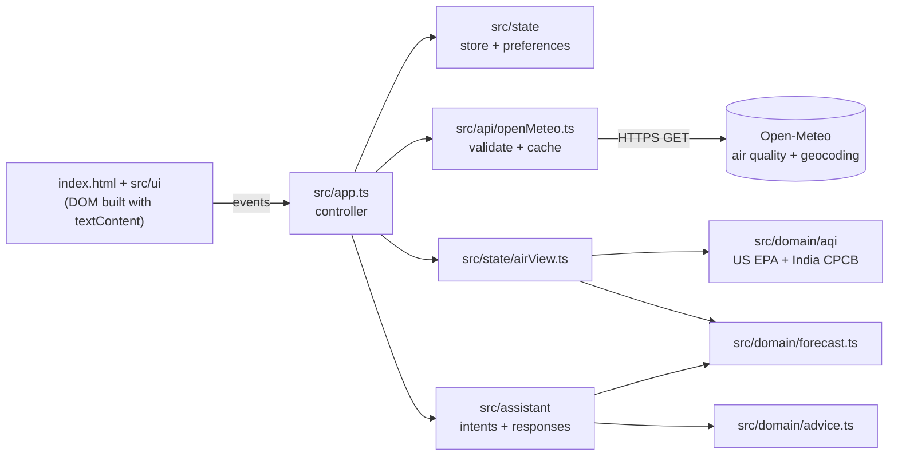

# AirWise: urban air quality assistant

**Live site: https://urban-air-quality-assistant-sigma.vercel.app**

AirWise tells city residents what the air is like where they are, what that means for them, and when it will be
better. It also answers plain-language questions such as *"Can my kid with asthma play outside tomorrow?"*.

It runs entirely in the browser on free, keyless public data, has no runtime dependencies, and ships 19 KB of
gzipped JavaScript.

## What it does

| A resident wants to know… | AirWise gives them… |
| --- | --- |
| How bad is the air right now? | The current AQI, its category and the main pollutant, on the **US EPA** or **India CPCB** scale. A circular gauge sweeps round to the reading, and the whole page (background glow, card, accents) takes on the category's colour. Each pollutant gets its own card with a level bar. |
| What should I do about it? | Advice tailored to their health (asthma, heart conditions, children, older adults, pregnancy, outdoor work) and plans (exercise, commuting, errands): outdoor activity, masks, windows and concrete actions. |
| When is it better? | A 48-hour hourly forecast with the cleanest two-hour daytime window highlighted, a trend, and the same figures as a table. |
| My own question | An assistant that understands questions about activities, times ("tonight", "tomorrow"), pollutants, masks, windows, causes and health groups, and answers from the live data. |

Other details:

- City search worldwide, or "Use my location".
- The AQI scale defaults to India CPCB for Indian locales and time zones, and US EPA elsewhere.
- Preferences and the last place are remembered on the device only.
- A dark, animated dashboard design, responsive down to 320 px.

## Run it

Requires Node.js 22.12 or later.

```bash
npm ci
npm run dev        # http://localhost:5173
npm run check      # type-check, lint, tests with coverage, production build
```

Other scripts: `npm test`, `npm run coverage`, `npm run build`, `npm run preview`.

## Deploy

The live site is hosted on Vercel, linked to this repository: every push to `main` deploys to production and
pull requests get preview deployments. `vercel.json` sets the build and output directory and adds the security
headers listed below (CSP, HSTS, `nosniff`, `frame-ancestors 'none'` and more).

`npm run build` produces a static site in `dist/` that any static host can serve. The build uses relative paths,
and the Content Security Policy is also in the HTML as a `<meta>` tag, so it still applies on hosts that cannot
set headers.

## How it works



The code is layered so each part can be tested on its own:

- **`src/domain`**: pure functions with no DOM or network access. Pollutant metadata, unit conversion, rolling
  averages, AQI breakpoints and calculation, health advice, forecast windows and local-time helpers.
- **`src/api`**: a fetch wrapper with timeouts and typed errors, a TTL + LRU cache that also merges concurrent
  requests, and the Open-Meteo client, which validates every response at runtime.
- **`src/state`**: a tiny observable store, validated persistence, and `buildAirView`, which turns raw data into
  everything the UI needs for one place and moment.
- **`src/assistant`**: a deterministic intent parser (activity, time, pollutant and health-group extraction) and a
  responder that grounds every answer in the current data and the user's profile.
- **`src/ui`**: render functions that return DOM nodes, an accessible SVG chart, and the controller in `src/app.ts`,
  which takes its dependencies (API client, storage, geolocation, clock) as arguments so it can be tested end to end.

### Why the assistant is rule-based

The assistant uses no language model, on purpose. Its answers are explainable and repeatable, can be fully tested,
work instantly and offline from cached data, need no API key, and never send a question off the device. It can
never make up a number: every figure comes from the AQI engine.

## AQI method

Concentrations come hourly from the [Open-Meteo air quality API](https://open-meteo.com/en/docs/air-quality-api),
which serves forecasts from the Copernicus Atmosphere Monitoring Service (CAMS). AirWise requests one past day
plus three forecast days, then calculates the index itself:

- **Averaging**: 24-hour means for PM2.5 and PM10 (and NO₂, SO₂ and NH₃ on the India scale), 8-hour means for O₃
  and CO, and 1-hour values for NO₂ and SO₂ on the US scale. An average needs at least two thirds of its hours,
  following CPCB's 16-of-24-hour rule.
- **US EPA**: breakpoints include the PM2.5 and PM10 revisions of May 2024. Gas concentrations are converted from
  µg/m³ to ppb/ppm at 25 °C and truncated to EPA's precision before the lookup.
- **India CPCB (NAQI)**: an index is published only when at least three pollutants, including PM2.5 or PM10, have
  data. CO uses mg/m³.
- The overall AQI is the highest sub-index, and that pollutant is reported as the main one.

Known simplifications: 8-hour ozone is capped at 300 on the US scale (EPA switches to 1-hour ozone above that), and
the open-ended top of CPCB's "Severe" band is given the same width as the band below it. Figures are model
estimates for the area, not readings from a local monitoring station, and the interface says so.

## Accessibility

Built to WCAG 2.2 AA:

- Semantic landmarks, one `h1`, a logical heading order, and a skip link.
- Every control has a visible or programmatic label. Groups use `fieldset`/`legend`. Every target is at least
  44 px.
- Status changes (searching, loaded, errors) are announced through a `role="status"` region, and the conversation
  through `role="log"`. After a place loads, focus moves to its heading.
- Colour is never the only signal: every AQI value comes with its category in words. The forecast chart is a
  labelled image with a text summary, plus a full data table.
- Motion is purposeful and optional. A new reading plays one choreographed reveal: the page colour shifts, the gauge
  sweeps round as the number counts up, pollutant bars fill and the forecast line draws itself. Changing your
  profile does not replay it. Sections fade in once as you scroll to them, and the assistant shows a brief typing
  indicator. Screen readers get a stable copy of the number rather than the count.
- The looping background glow and live indicator can be stopped with the **Pause animation** button (WCAG 2.2.2),
  and the choice is remembered. When the system asks for reduced motion, every animation is skipped and the typing
  delay is removed.
- Visible focus rings, support for `prefers-reduced-motion` and Windows forced-colours mode, and no horizontal
  scrolling at 320 px except inside the labelled, keyboard-focusable chart region.
- Automated checks: axe-core runs in the tests against each component and the whole page, both empty and with data
  loaded.

## Security

The details are in [SECURITY.md](SECURITY.md). In brief:

- A strict CSP (`default-src 'none'`, no inline code, Trusted Types enforced) and network access limited to the
  two API origins.
- No HTML string sinks anywhere: the linter bans them and the browser blocks them.
- Runtime validation of every API response and every stored preference.
- No secrets, no cookies, no referrer, no analytics. Location is rounded to about 1 km before it is sent.
- Hosting headers: HSTS, `nosniff`, `frame-ancestors 'none'` and a restrictive `Permissions-Policy`.
- Zero runtime dependencies, `npm audit` in CI, and Dependabot.

## Efficiency

- No framework and no runtime dependencies: 51 KB of JavaScript (19 KB gzipped) and 23 KB of CSS (5.8 KB gzipped).
- Animation is CSS keyframes (mostly `transform`, `opacity` and SVG stroke offsets) plus one `requestAnimationFrame` count-up, with no animation library. One registered CSS colour property, `--tone`, carries the AQI colour to every element, so a new reading recolours the page without re-rendering it. Scroll reveals use `IntersectionObserver` rather than scroll listeners.
- One request per place: hourly data for every pollutant comes in a single call, and switching between the US and
  India scales recalculates locally without refetching.
- Responses are cached (15 minutes for air quality, 24 hours for place search), and concurrent identical requests
  share one fetch. Results that arrive after the user has moved on are discarded.
- The derived view is memoised per data set, scale and hour. Lists use event delegation, and the conversation log
  is capped.
- No polling: data refreshes only when the tab becomes visible again and the data is more than 30 minutes old.
- No web fonts: the page uses system font stacks.

## Testing

319 tests in 20 files ([Vitest](https://vitest.dev) with jsdom), at 98.5% statement and 93.7% branch coverage.
CI enforces minimums of 90% and 85%.

| Area | What is covered |
| --- | --- |
| AQI engine | Breakpoint boundaries for both scales, unit conversion and truncation, averaging and data completeness, CPCB's three-pollutant rule, category edges |
| Forecast and advice | Best-window search (hours allowed, gaps, ties), daily summaries, trend detection, risk for each level and group, mask and window guidance |
| Assistant | 26 phrasings mapped to intents, entity extraction, and the exact wording of answers for clean, unhealthy and hazardous air, future times and missing data |
| API | Timeouts, cancellation, HTTP, parse and network errors, response validation, input sanitising, caching, request merging, TTL |
| UI and app | Every render state, the gauge geometry and labels, the forecast line (gaps, tooltips, band colours), when the reveal plays and when it doesn't, count-up timing, scroll reveal, the typing indicator, reduced motion, the full search → select → ask flow, scale and profile changes, retry, geolocation outcomes, stale-response handling, XSS payloads rendered as text, persistence |
| Accessibility | axe-core (WCAG 2.2 AA and best practice) on components and the whole page |
| Security config | CSP identical in the build and the headers, only the APIs actually called allowed, no inline scripts or handlers in the HTML |

## Project layout

```
config/csp.ts          Content Security Policy shared by the build and the hosting headers
index.html             Static, semantic page shell
src/main.ts            Entry point: wires real browser dependencies into the app
src/app.ts             Controller: events, state, rendering, focus management
src/api/               HTTP, cache, Open-Meteo client and validation
src/assistant/         Intent parser and grounded responder
src/domain/            AQI engine, advice, forecast, units, time (pure functions)
src/state/             Store, preferences, derived air view
src/ui/                DOM helper, gauge, line chart, icons, motion and components
src/styles.css         Design tokens and layout
vercel.json            Security and caching headers
```

## Limitations and next steps

- CAMS data is a model at roughly 10 km (Europe) to 40 km (global) resolution, so it can miss street-level hotspots.
  Blending in nearby station readings (for example from CPCB or OpenAQ) would sharpen it.
- The assistant understands English only. Hindi and other regional languages would be the most useful addition in
  Indian cities.
- Possible additions: alerts when air is forecast to cross a threshold, and installable offline support.

## Data and disclaimer

Air quality and geocoding data: [Open-Meteo](https://open-meteo.com) (CC BY 4.0), based on the
[Copernicus Atmosphere Monitoring Service](https://atmosphere.copernicus.eu). AirWise gives general guidance based on
public health messaging from the US EPA and CPCB. It is not medical advice.

## License

[MIT](LICENSE)
